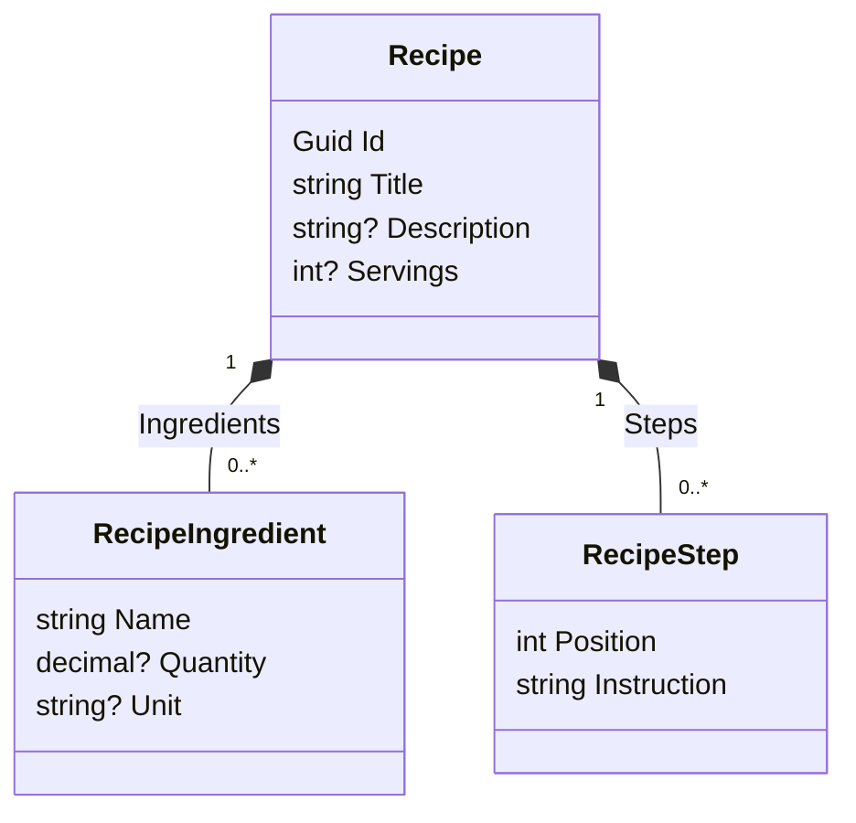
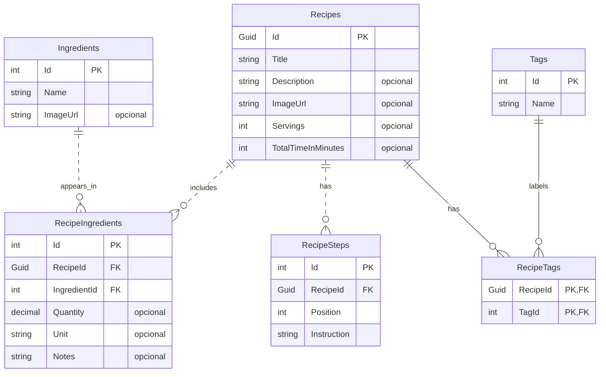

# Diagrama de dados do Mom Recipes

## Estado atual

`Recipe` é a raiz do agregado. Cada receita contém os seus ingredientes e passos, que são objetos de valor. O repositório atual guarda as receitas em memória.

## Modelo relacional proposto

O modelo prevê um catálogo partilhado de ingredientes e etiquetas reutilizáveis para receitas.

- `RecipeIngredients` tem um `Id` próprio para permitir que o mesmo ingrediente apareça mais de uma vez na receita. Quando há uma quantidade mensurável, `Quantity` guarda o valor e `Unit` usa uma unidade consistente, como `g` ou `ml`. Para «sal q.b.», `Notes` guarda «q.b.» e a quantidade e a unidade ficam vazias.
- `RecipeSteps` guarda as instruções pela ordem de preparação. A combinação de `RecipeId` e `Position` deve ser única.
- `RecipeTags` usa `(RecipeId, TagId)` como chave composta para impedir que a mesma etiqueta seja atribuída duas vezes à receita.
- As cardinalidades permitem guardar uma receita em rascunho com zero ingredientes, passos ou etiquetas.
