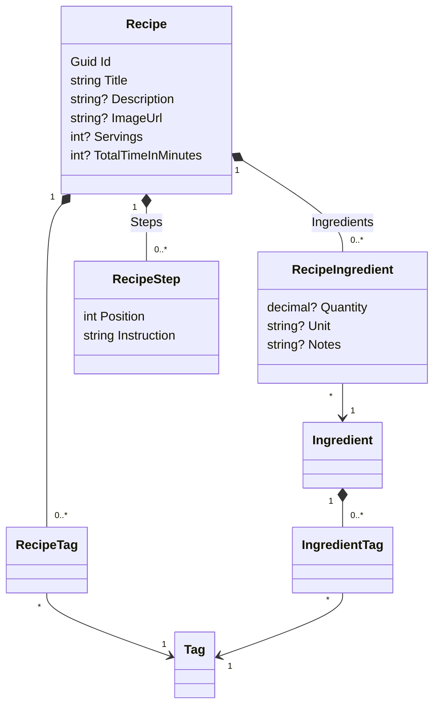
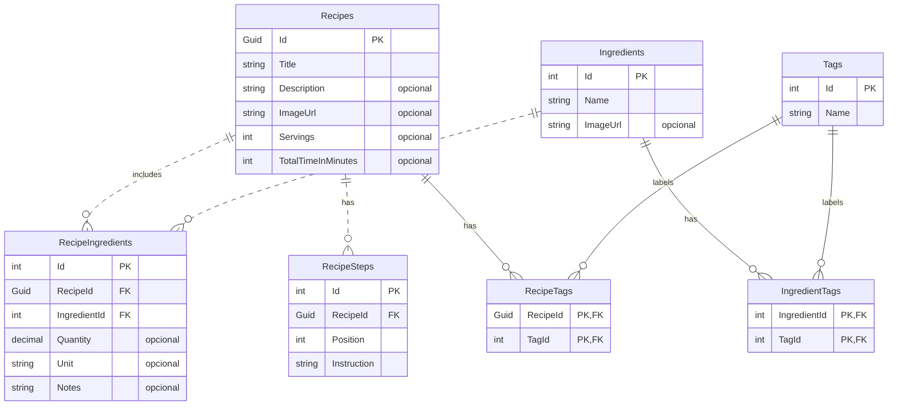

# Diagrama de dados do Mom Recipes

## Estado atual

`Recipe` é a raiz do agregado. Cada receita contém passos e referências aos ingredientes que utiliza. Receitas e ingredientes podem partilhar as mesmas etiquetas. O repositório usa PostgreSQL com Entity Framework Core Code First.

## Modelo relacional

O esquema é criado pelas migrações do projeto `MomRecipes.Infrastructure`.

- `RecipeIngredients` tem um `Id` próprio para permitir que o mesmo ingrediente apareça mais de uma vez na receita. Quando há uma quantidade mensurável, `Quantity` guarda o valor e `Unit` usa uma unidade consistente, como `g` ou `ml`. Para «sal q.b.», `Notes` guarda «q.b.» e a quantidade e a unidade ficam vazias.
- `RecipeSteps` guarda as instruções pela ordem de preparação. A combinação de `RecipeId` e `Position` deve ser única.
- `RecipeTags` e `IngredientTags` usam chaves compostas para impedir atribuições repetidas. Ambas têm um índice que começa por `TagId` para filtrar por etiqueta.
- As cardinalidades permitem guardar uma receita em rascunho com zero ingredientes, passos ou etiquetas.
